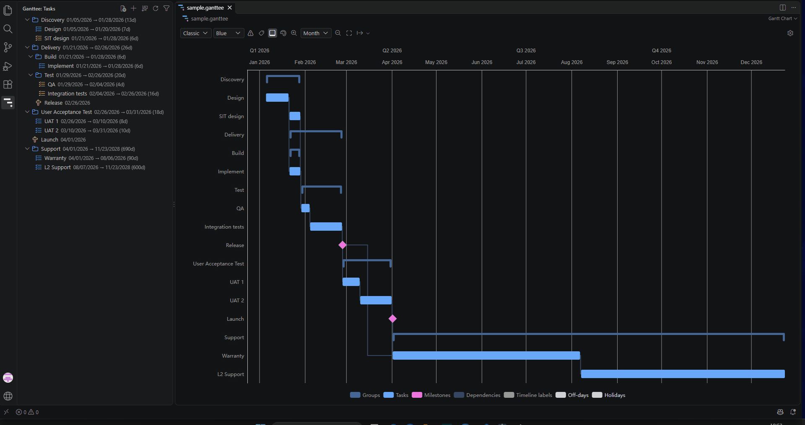
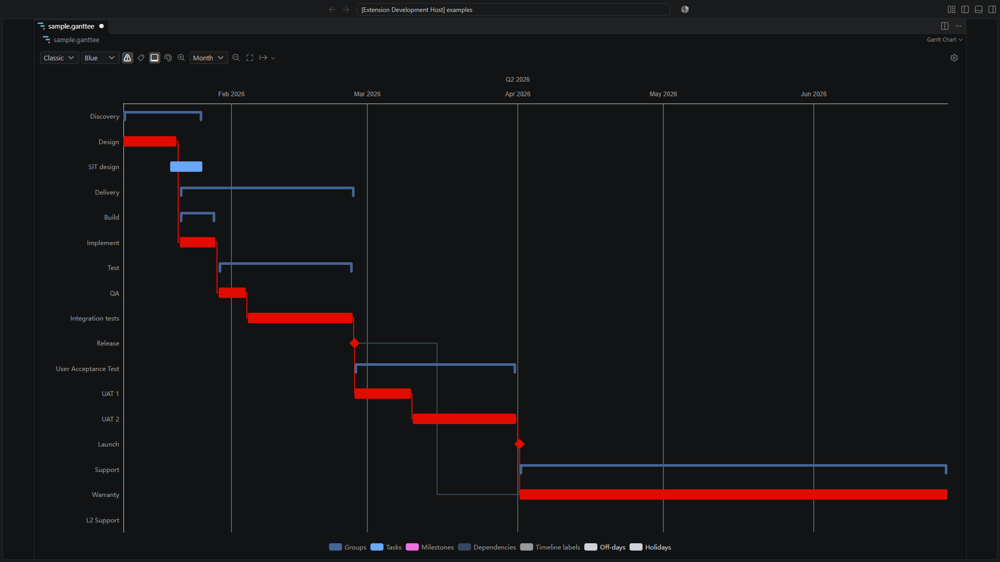
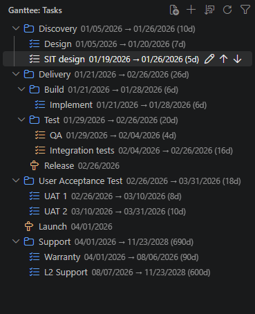
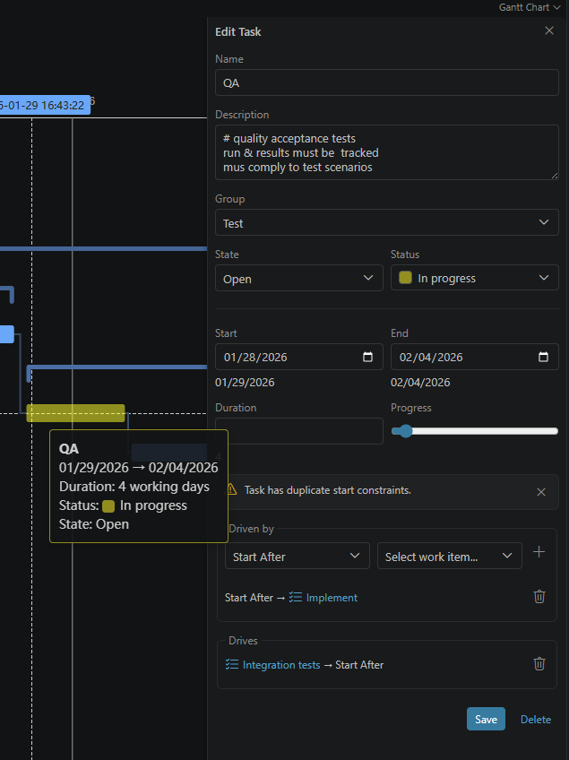
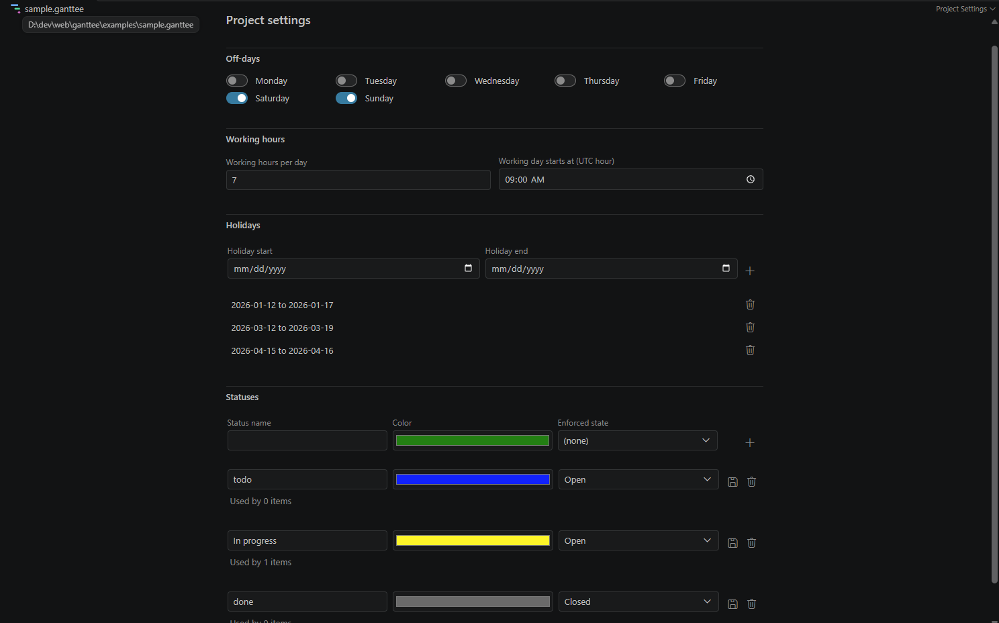

# Ganttee

Plan projects without leaving VS Code. Ganttee is an interactive Gantt chart editor for `.ganttee`
files: tasks, groups, milestones, dependencies, working calendars, and a critical path, all in a
plain JSON file that you can version with your code.

## Quick Start

1. Install the extension.
2. Open the **Ganttee** view in the Activity Bar and select **New Project**, or open any `.ganttee`
   file (for example
   [examples/sample.ganttee](https://github.com/sergehas/ganttee/blob/main/examples/sample.ganttee)).
3. Add tasks, groups, and milestones from the **Tasks** view toolbar.
4. Double-click an item in the chart (or select **Edit Item** in the tree) to edit it.

## Features

### Interactive Timeline

- **Tasks, groups, and milestones** on one timeline. Group bars span all their descendants.
- **Drag task bars** to move them in time. **Double-click** any item to open its edit form.
- **Five zoom levels** (day, week, month, quarter, year), zoom in and out, and **fit to window**.
- **Two-level time header** (for example, months over weeks) with ISO 8601 week numbers.
- **Three visual styles**: _Classic_, _Rounded_, and _Metro_ (a metro-map look for dependency
  routes).
- **Color themes**: _Blue_, _Blue (light)_, and _Green_.
- **Item labels** on the bars or on the axis.
- **Export the chart** as SVG or PNG, to a file or to the clipboard.
- Zoom level, style, theme, and layer visibility are saved in the document.

### Dependencies and Critical Path

- Three dependency types: **start after** (finish-to-start), **start with** (start-to-start), and
  **end with** (finish-to-finish).
- **Critical path highlighting** shows the longest dependency chain across tasks, milestones,
  groups, and links.
- Toggle dependencies, off-days, holidays, and the critical path from the chart legend.

### Scheduling Engine

- **Automatic scheduling** after each edit: effective start, end, and duration come from dates,
  durations, and dependencies.
- **Working calendar**: working-day start time, hours per day, and days off (Saturday and Sunday by
  default).
- **Holidays**: inclusive date ranges that scheduling skips, shaded on the chart.
- **Group roll-up** from the earliest start to the latest end of all descendants.
- **Validation**: rejects dependency cycles and reports items that are under- or over-constrained or
  have no anchor date.

### Tasks View

- **Create** projects, tasks, groups, and milestones from the toolbar.
- **Edit**, **move up**, and **move down** from inline row actions. **Delete** one item or the whole
  multi-selection from the context menu.
- **Drag and drop** items to group or ungroup them. Invalid or cyclic moves are rejected.
- **Sort** the whole tree by effective dates or name, ascending or descending.
- **Filter** the tree by item name.
- **Status badges** and type icons for each item.

### Edit Forms

- One form for each item kind: name, description, dates, state, status, parent group, and
  dependencies.
- Give any two of **start**, **duration**, and **end** for a task. Ganttee computes the third and
  shows the effective schedule.
- Inline validation feedback before the change is applied.

### Project Settings

- A dedicated **Project Settings** editor for each `.ganttee` file.
- Edit the working calendar and holiday ranges.
- Define **custom statuses** with a color and an optional enforced state (open or closed). Usage
  counts are shown, and deletion asks for confirmation.

### Other

- **Plain-text source of truth**: the `.ganttee` file is JSON. Undo, redo, diff, and source control
  work as usual. Older files are migrated automatically.
- **Localized** in English and French. Ganttee follows your VS Code display language.

## Commands

| Command               | Where                                     |
| --------------------- | ----------------------------------------- |
| New Project           | Tasks view toolbar                        |
| New Task              | Tasks view toolbar (**New Items** menu)   |
| New Group             | Tasks view toolbar (**New Items** menu)   |
| New Milestone         | Tasks view toolbar (**New Items** menu)   |
| Edit Item             | Tasks view row action, chart double-click |
| Move Up / Move Down   | Tasks view row actions                    |
| Delete Item           | Tasks view context menu                   |
| Delete Selected Items | Tasks view context menu                   |
| Sort                  | Tasks view toolbar                        |
| Filter                | Tasks view toolbar                        |
| Refresh               | Tasks view toolbar                        |
| Project Settings      | Command Palette                           |

## Extension Settings

Ganttee does not add VS Code settings. All settings (calendar, holidays, statuses, and view
preferences) are stored in each `.ganttee` file and edited in the **Project Settings** editor.

## Requirements

VS Code 1.138.0 or later. No other dependency.

## Known Issues

- Off-days and holidays are shaded but cannot be collapsed out of the timeline yet.
- Validation problems are shown in the Tasks view, not yet in the **Problems** panel.

Report other issues in the [issue tracker](https://github.com/sergehas/ganttee/issues).

## Release Notes

See the [changelog](https://github.com/sergehas/ganttee/blob/main/docs/CHANGELOG.md).

## Contributing

Contributions are welcome. Read [CONTRIBUTING.md](docs/CONTRIBUTING.md) and the
[Code of Conduct](docs/CODE_OF_CONDUCT.md). Report security issues as described in
[SECURITY.md](docs/SECURITY.md).

> [!NOTE]
>
> **AI-assisted development.** This extension has been developed using AI. AI coding assistants
> wrote a large part of the code, tests, and documentation, under human direction and review. Every
> change goes through the same CI quality gates (type checks, lint, tests, and ≥ 90% branch
> coverage). Please report any problem in the
> [issue tracker](https://github.com/sergehas/ganttee/issues).

---

## License and Acknowledgements

This project is licensed under the **GNU Affero General Public License v3.0 or later
(AGPL-3.0-or-later)**. See the [LICENSE](LICENSE) file for the full license text.

## Third-Party Component Licenses

This project dependencies are installed via `npm`. It dynamically links and interacts with several
open-source libraries under the following compliant licenses:

The explicit runtime dependencies listed in `package.json` are:

- **[@vscode/codicons](https://github.com/microsoft/vscode-codicons)** - Licensed under the Creative
  Commons Attribution 4.0 International License (CC BY 4.0).
- **[Apache ECharts](https://echarts.apache.org)** - Licensed under the Apache License 2.0.
- **[Graphology](https://github.com/graphology/graphology)** - Licensed under the MIT License.
- **[graphology-components](https://github.com/graphology/graphology)** - Licensed under the MIT
  License.
- **[graphology-dag](https://github.com/graphology/graphology)** - Licensed under the MIT License.
- **[React](https://react.dev)** - Licensed under the MIT License.
- **[React DOM](https://react.dev)** - Licensed under the MIT License.

Development dependencies are excluded from this list. No explicit runtime dependency is licensed
under GPLv3.

---

_Note: In accordance with the AGPL-3.0, if you modify this software and run it on a server to offer
network services to the public, you must make your modified source code available._
