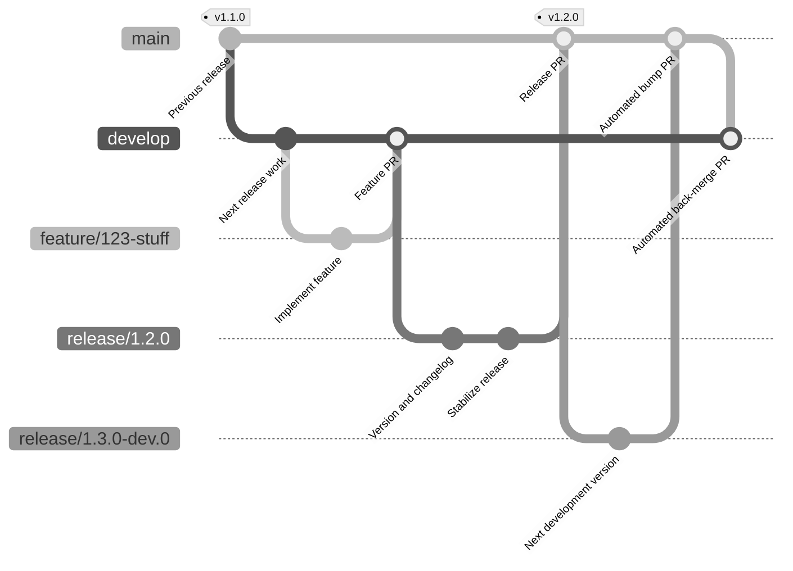
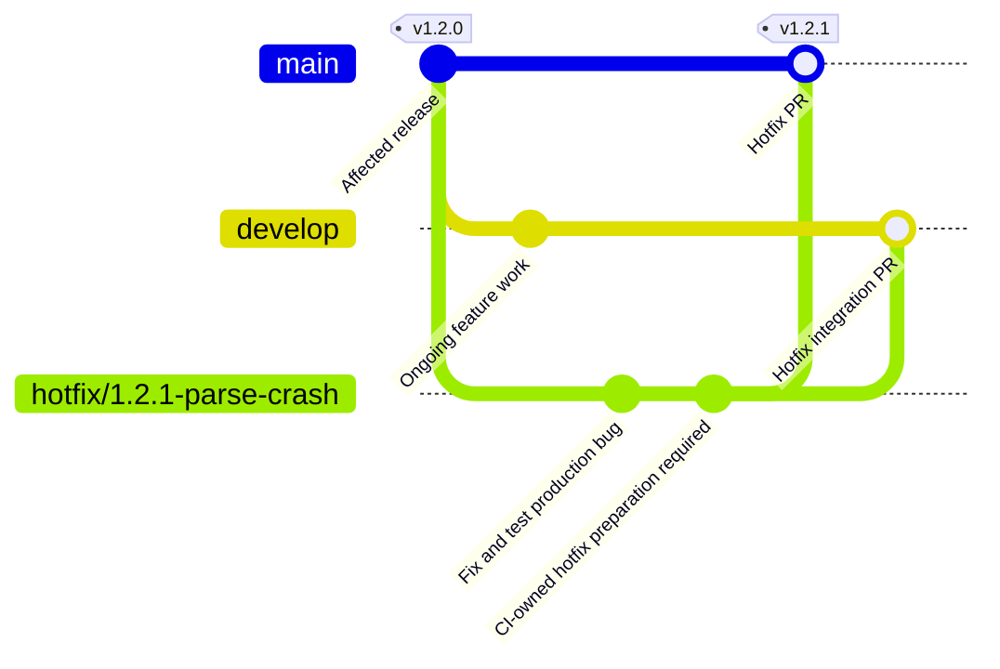
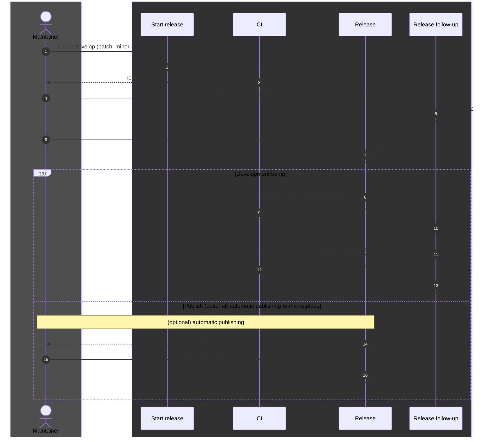

# Branch Protection, Gitflow, and Release Process

- Follow **Gitflow** for branch roles and merge paths.
- Configure **Branch Protection** for rulesets and required checks.
- Follow **Release Process** for setup, automation, and user actions.

## Table of Contents

- [Gitflow](#gitflow)
  - [Branch Roles](#branch-roles)
  - [Feature and Release Lifecycle](#feature-and-release-lifecycle)
  - [Hotfix Lifecycle](#hotfix-lifecycle)
- [Branch Protection](#branch-protection)
  - [Rulesets](#rulesets)
  - [Required Checks](#required-checks)
  - [Import the Rulesets](#import-the-rulesets)
- [Release Process](#release-process)
  - [Release Steps](#release-steps)
  - [Release Sequence](#release-sequence)
  - [Release Jobs](#release-jobs)
  - [Release Prerequisites](#release-prerequisites)
  - [Release Branch Cleanup](#release-branch-cleanup)

## Gitflow

### Branch Roles

- `main`: merge stable releases, then automated development-version bumps. Identify published
  versions by release tags, not the branch tip.
- `develop`: integrate work for the next release.
- `feature/<issue-id>-<summary>`: branch from `develop`; implement and test; open a PR to `develop`.
  Merge after review and checks; delete when finished.
- `release/X.Y.Z`: run **Start release** on `develop`; stabilize; merge the PR to `main`. Run
  **Release**; let automation synchronize `develop`.
- `hotfix/<version>-<summary>`: branch from `main`, or the affected release tag if the development
  bump has merged. Test; open PRs to `main` and `develop`. Prepare and merge manually; no hotfix
  workflow exists.
- `fix/<issue-id>-<summary>`: follow the feature process for non-urgent fixes.

### Feature and Release Lifecycle

Release `1.2.0`, then start `1.3.0-dev.0`. Merge nodes represent PR merges; CI and deletion are
omitted. Feature PRs may use squash merges.



### Hotfix Lifecycle

- Start from the affected release tag if `main` has a development bump.
- Prepare a stable hotfix version and changelog before running **Release**.
- Do not bump versions or create tags by hand. Add a CI-owned preparation step first: current
  workflows lack it; **Start release** requires `develop`.

The example assumes `main` still points to `v1.2.0`. The preparation node is a required step, not an
existing workflow; **Release** creates `v1.2.1`.



- Delete the hotfix branch after both PRs merge; cleanup is not automated.
- Keep the automated development bump and back-merge after a hotfix release.
- Resolve back-merge conflicts before continuing.

## Branch Protection

Import the [ruleset definitions](../../.github/rulesets) as a repository admin. Repeat after
changes; GitHub does not apply local definitions automatically. See
[GitHub rulesets](https://docs.github.com/repositories/configuring-branches-and-merges-in-your-repository/managing-rulesets/about-rulesets).

### Rulesets

| File                  | Target                    | Rules                                                                                                                                                                        |
| --------------------- | ------------------------- | ---------------------------------------------------------------------------------------------------------------------------------------------------------------------------- |
| `main.json`           | `main`                    | No deletion, no force push. Pull request with 1 approval, stale approvals dismissed, conversations resolved, merge commits only. All CI checks pass on an up-to-date branch. |
| `develop.json`        | `develop`                 | Same as `main`, but merge commits and squash merges are allowed.                                                                                                             |
| `release-hotfix.json` | `release/**`, `hotfix/**` | No force push. Creation and deletion are allowed, so the **Start release** workflow can create release branches and merged branches can be deleted.                          |
| `tags.json`           | `v*` tags                 | Release tags cannot be moved or deleted. Creation is allowed, so the **Release** workflow can push them.                                                                     |

- Allow admin bypass **for PRs only** on `main` and `develop`; no direct pushes.
- Use it to merge your own PR or automated follow-up PRs after checks pass.
- Remember: bypass covers checks too. **Release follow-up** verifies CI, required checks, and the
  unchanged PR head before merging.
- To enforce checks independently, use a separate ruleset without bypass.

### Required Checks

The required status checks are the job names of [ci.yml](../../.github/workflows/ci.yml):

- `Dependency audit`
- `Quality (type-check + format:check + lint)`
- `Build`
- `Integration tests (ubuntu-latest)` and `Integration tests (windows-latest)`
- `VS Code tests (ubuntu-latest)` and `VS Code tests (windows-latest)`

After renaming a job or changing its matrix, update and reimport `main.json` and `develop.json`.
Otherwise PRs wait for missing checks.

### Import the Rulesets

Open **Settings** > **Rules** > **Rulesets** > **New ruleset** > **Import a ruleset**. Import each
JSON file.

With the GitHub CLI (repository admin), from the repository root:

```sh
OWNER="theOwner"
REPO="theRepo"
for file in .github/rulesets/*.json; do
  gh api --method POST repos/${OWNER}/${REPO}/rulesets --input "$file"
done
```

To update a ruleset, get its ID with `gh api repos/${OWNER}/${REPO}/rulesets`. Send the file with
`--method PUT` to `repos/${OWNER}/${REPO}/rulesets/<id>`.

## Release Process

### Release Steps

1. **User:** run **Start release** on `develop`; choose patch, minor, or major. **Auto:** bump the
   version, promote `Unreleased`, create `release/X.Y.Z`, and open a PR to `main`.
2. **User:** review, stabilize, and merge after checks pass. **Auto:** delete the unchanged release
   branch.
3. **User:** run **Release** on `main`. **Auto:** test, package, create `vX.Y.Z`, and attach the
   VSIX to a GitHub Release.
4. **Auto:** run `npm version preminor --preid dev --no-git-tag-version`; open the development bump
   PR. After `1.2.0`, use `release/1.3.0-dev.0`.
5. **Auto:** verify CI and required checks; merge the bump PR; delete its unchanged branch; open and
   merge `main` to `develop` after checks pass.
6. **User:** approve the `marketplace` deployment. **Auto:** publish the tagged VSIX unchanged using
   OIDC.

Publishing and the development bump run independently after release creation. Publishing does not
wait for the back-merge.

### Release Sequence

Every arrow from `Maintainer` is a user action; all other arrows are automatic. `par` blocks run in
parallel.



### Release Jobs

| Job                             | Trigger                                                     |
| ------------------------------- | ----------------------------------------------------------- |
| Start release / `start-release` | **Manual**: `workflow_dispatch` on `develop`                |
| Release / `release`             | **Manual**: `workflow_dispatch` on `main`                   |
| Release / `development-bump`    | **Auto**: after `release` succeeds                          |
| Release / `publish`             | **Auto** after `release`; **manual** `marketplace` approval |
| Release follow-up / `merge`     | **Auto**: CI succeeds on a PR                               |
| Release follow-up / `cleanup`   | **Auto**: `release/*` PR merges into `main`                 |

**Start release** › `start-release` — **Manual** (`workflow_dispatch` on `develop`):

1. Require develop branch: stop when run on another branch.
2. Checkout: fetch the repository with `RELEASE_TOKEN` (fallback `GITHUB_TOKEN`).
3. Setup Node: install Node 24.
4. Configure git identity: commit as `github-actions[bot]`.
5. Bump version: run `npm version <bump>` without a tag.
6. Check release branch and tag are free: fail if `release/X.Y.Z` or `vX.Y.Z` exists.
7. Promote changelog: move `Unreleased` entries under `X.Y.Z`.
8. Commit and push release branch: commit version files on `release/X.Y.Z`.
9. Open pull request to main: create the release PR.
10. Warn when CI will not start: warn if `RELEASE_TOKEN` is missing.

**Release** › `release` — **Manual** (`workflow_dispatch` on `main`):

1. Require release automation token: fail without `RELEASE_TOKEN`.
2. Require main branch: stop when run on another branch.
3. Checkout: fetch `main` with `RELEASE_TOKEN`.
4. Setup Node: install Node 24 with npm cache.
5. Read version: output `X.Y.Z` and `vX.Y.Z`.
6. Check publisher and tag: require stable version, real publisher, and no conflicting tag.
7. `npm ci`: install dependencies.
8. Run tests: run `npm test` under `xvfb`.
9. Package VSIX: build `ganttee-X.Y.Z.vsix`.
10. Extract release notes: read the `X.Y.Z` changelog section.
11. Create tag: create and push `vX.Y.Z` if missing.
12. Create GitHub Release: create the release with the VSIX, or upload a missing asset.

**Release** › `development-bump` — **Auto** (after `release` succeeds):

1. Require release automation token: fail without `RELEASE_TOKEN`.
2. Checkout: fetch `main` with `RELEASE_TOKEN`.
3. Setup Node: install Node 24.
4. Configure git identity: commit as `github-actions[bot]`.
5. Commit next development version: run `npm version preminor --preid dev`; push
   `release/X.Y.Z-dev.0` unless it already holds that version.
6. Open development bump PR: create the PR to `main` if none is open.

**Release** › `publish` — **Auto** (after `release` succeeds), then waits for **manual**
`marketplace` approval. Runs [publish.yml](../../.github/workflows/publish.yml):

1. Validate tag: require `vX.Y.Z`.
2. Checkout: fetch the tagged commit.
3. Setup Node: install Node 24.
4. Download VSIX: fetch the asset from the GitHub Release.
5. Publish to Marketplace: require exactly one VSIX; run `vsce publish --oidc`.

**Release follow-up** › `merge` — **Auto** (`workflow_run`: CI succeeds on a PR):

1. Merge matching automation PR: select bump PR (to `main`) or back-merge PR (to `develop`); match
   head SHA, author, repository, and title; for bump PRs, require only package-file changes and a
   matching version; check required checks; merge with `--admin`.

**Release follow-up** › `cleanup` — **Auto** (`pull_request_target`: `release/*` PR merges into
`main`):

1. Require release automation token: fail without `RELEASE_TOKEN` for `-dev.0` branches.
2. Delete only the merged release branch: delete when the head is unchanged; warn otherwise.
3. Open development back-merge PR: after a bump merge, verify author and version; open `main` to
   `develop` PR if none is open.

CI jobs are listed in [Required Checks](#required-checks).

- Merge follow-up PRs only after successful CI, required checks, and matching repository, author,
  title, branch, and tested head. Use the admin PR-only bypass.
- Review ordinary feature, release, and hotfix PRs manually.
- Resolve failed checks, conflicts, changed heads, or PR creation failures; rerun or complete the
  affected step.
- Expect `main` to retain the stable version until the bump PR merges.
- To publish an existing release, dispatch **Publish** with `vX.Y.Z`; use the same asset and
  approval gate. Non-prerelease publication events also trigger it.
- **Release** calls **Publish** directly. Its `GITHUB_TOKEN` release event does not trigger
  duplicate publication.

### Release Prerequisites

Complete before the first release:

1. **Publisher:** create a publisher with your personal Microsoft account at
   [Marketplace management](https://marketplace.visualstudio.com/manage). Set its ID in
   `package.json`; **Release** rejects `tbd-publisher`.
2. **Trusted publishing:** add a policy for this repository and publishing workflow. Match the
   Marketplace workflow identity; follow
   [`vsce` OIDC setup](https://github.com/microsoft/vscode-vsce#trusted-publishing). No Azure
   subscription, Azure DevOps organization, managed identity, or Marketplace PAT is required.
   Replace pinned `vsce@4.0.1-3` when an OIDC-capable stable release becomes available.
3. **Environment:** create `marketplace` under **Settings** > **Environments**. Add reviewers; allow
   deployment from `main` and `v*`. Do not create `VSCE_PAT` for OIDC.
4. **Release token:** create an admin-owned, repository-scoped fine-grained PAT with **Contents**
   and **Pull requests** read/write. Store it as `RELEASE_TOKEN` under **Settings** > **Secrets and
   variables** > **Actions**. Cover its owner with PR-only bypass on `main` and `develop`; renew
   before expiry. Use a user-owned PAT, not a GitHub App token. It pushes branches, opens PRs,
   triggers CI, and merges follow-ups. `GITHUB_TOKEN` does not inherit admin privileges.
5. **Permissions:** enable **Allow GitHub Actions to create and approve pull requests** under
   **Settings** > **Actions** > **General**. Keep `id-token: write` on the publishing caller and
   reusable workflow.
6. **Private reporting:** enable **Private vulnerability reporting** under **Settings** > **Code
   security** for [SECURITY.md](../SECURITY.md) and [CODE_OF_CONDUCT.md](../CODE_OF_CONDUCT.md).

Azure DevOps global PATs retire **December 1, 2026**; Marketplace OIDC is unaffected. See the
[retirement notice](https://devblogs.microsoft.com/devops/retirement-of-global-personal-access-tokens-in-azure-devops/).
For contributor steps, see [CONTRIBUTING.md](../CONTRIBUTING.md#releases).

### Release Branch Cleanup

- Install **Release follow-up** on the default branch before releasing.
- Delete only same-repository `release/*` branches merged into `main`, with unchanged heads. The
  workflow performs this cleanup.
- Keep `main`, `develop`, fork branches, and tags.
- Leave repository-wide automatic branch deletion disabled; it is not required.
