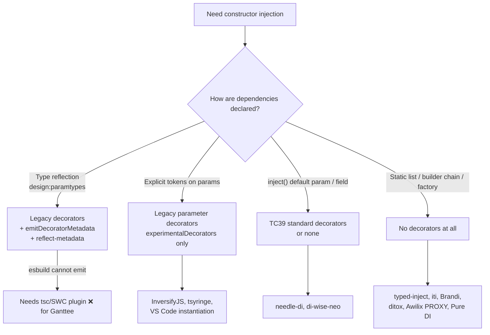
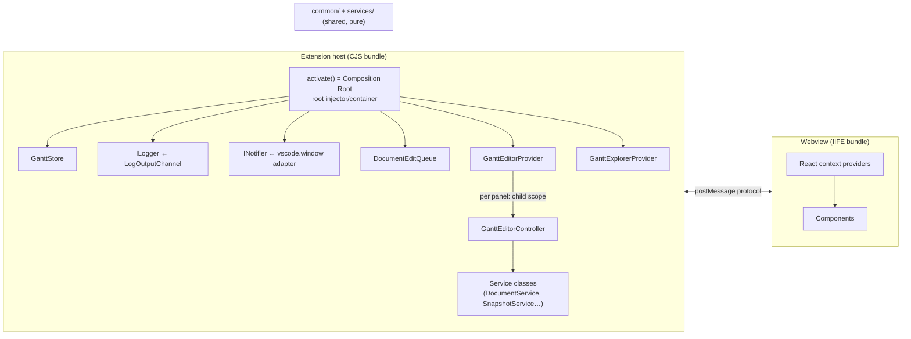

# Dependency Injection Research: Library Options for Ganttee

_Research date: 2026-10-31. Query type: conceptual / technical comparison._

## Executive Summary

Ganttee already uses manual constructor injection. `activate()` builds the object graph by hand. But
there are no abstractions (interfaces or tokens), `services/` is made only of free functions, and
`views/` calls the static `vscode.*` namespaces directly[^1][^2]. The build sets a hard limit:
esbuild never emits `emitDecoratorMetadata`, and decorators are off in all tsconfigs[^3]. So any
library that infers dependencies from types by reflection (TypeDI, tsyringe or InversifyJS
auto-wiring) needs an explicit `@inject(token)` on every parameter, or an extra compiler plugin.
Three options fit Ganttee's constraints best:

1. **typed-inject**: no decorators, missing dependencies fail at compile time, ~1.3 kB gzip.
2. **@needle-di/core**: TC39 standard decorators plus `inject()`, no reflection.
3. **Pure DI**: a typed composition root with no library, as GitLens does.

**InversifyJS 8** is the most widely used option that is still actively maintained. It is a valid
choice if you accept legacy decorators, `reflect-metadata` and ~20.7 kB gzip. **TypeDI** is
effectively dead and should not be used.

---

## 1. Baseline: what Ganttee looks like today

### 1.1 Wiring

```ts
// src/extension.ts:18-36 (abridged)
const store = new GanttStore();
const log = vscode.window.createOutputChannel("Ganttee", { log: true });
context.subscriptions.push(GanttEditorProvider.register(context, store, log));
const explorer = new GanttExplorerProvider(store, context.extensionUri);
const treeView = vscode.window.createTreeView(GanttExplorerProvider.viewId, {...});
registerCommands(context, store, explorer, treeView);
```

- **Composition root:** `activate()` is already a de facto composition root. 16 commands are
  registered as closures that reach the editor through `store.active?.…`[^1].
- **`GanttEditorProvider.register`:** a static factory. It creates one shared `DocumentEditQueue`
  and two provider instances[^4].
- **Per-panel controller:** each webview panel gets its own `GanttEditorController` with 6
  constructor parameters. This is a natural candidate for a **child scope** (scoped or per-document
  lifetime)[^4].
- **Hard-wired imports:** the controller calls ~15 service free functions directly (for example
  `parseDocument`, `hydrateDocument` and `createProjectSnapshot`). It also calls
  `vscode.window.show*Message`, `vscode.workspace.applyEdit` and `vscode.commands.executeCommand`
  inline[^2].
- **Services are functions, not classes:** under `src/services/**` the only classes are error
  types[^5]. Domain classes in `common/models` are immutable value objects (`ProjectModel`, `Task`,
  `Milestone`, `Group`, `ProjectDependencyGraph extends DirectedGraph`)[^5].
- **Webview singleton:** the webview has one module singleton, `acquireVsCodeApi()` in
  `vscodeApi.ts:15`. Localization reaches React components through a React context[^5].

### 1.2 Build and compiler constraints

| Constraint                                         | Value                                                                           | Impact on DI choice                                                                           |
| -------------------------------------------------- | ------------------------------------------------------------------------------- | --------------------------------------------------------------------------------------------- |
| `experimentalDecorators` / `emitDecoratorMetadata` | Not set in any tsconfig[^3]                                                     | Legacy-decorator libraries need a config change                                               |
| `useDefineForClassFields`                          | Implicit `true` (target ES2022)[^3]                                             | Field-injection patterns work with native semantics                                           |
| Bundler                                            | esbuild 0.28, CJS (host) + IIFE (webview), no metadata plugin[^3]               | esbuild does **not** support `emitDecoratorMetadata`[^6]                                      |
| Test compile                                       | `tsc` + `tsc-alias` into `out/`[^3]                                             | With metadata enabled, tests (tsc) and bundles (esbuild) would behave **differently**: a trap |
| TypeScript                                         | 6.0.3, pinned to 6.x by ADR 0003[^3]                                            | TS 6 does **not** deprecate the decorator flags. TS 7 (tsgo) supports both[^7]                |
| Packaging                                          | `vsce package --no-dependencies`[^3]                                            | Every runtime dependency must be bundled, so size matters                                     |
| Runtime deps                                       | codicons, echarts, graphology×3, react/react-dom; **no** `reflect-metadata`[^3] | Adding a DI library is a new runtime dependency                                               |

### 1.3 Architectural rules any DI choice must respect

- **DIP rule:** "Depend on abstractions… Inject dependencies through constructors/parameters rather
  than reaching for globals or singletons" (DIP)[^8].
- **Boundary rule:** `common/` and `services/` must not import `vscode`, Node or DOM. They are
  shared with the browser webview[^9]. Any DI library imported into `services/` therefore also ships
  in the webview bundle.
- **No premature abstraction:** add seams only where change already happens. When a principle
  conflicts with the boundary rules, the boundary rules win[^8].
- **Tests:** "Do not stub globals; make the dependency injectable"[^10].
- ⚠️ **Conflicting guidance:**
  - `copilot-instructions.md` says there is "no internal service DI container".
  - `coding-guidelines.instructions.md:126-131` (inherited from VS Code core) says to use
    `@ISomeService` constructor parameters.
  - Choosing a DI approach must resolve this contradiction, preferably in an ADR[^11].
- **No prior decision:** no existing ADR or spec (including `in-memory-oo-model`) covers DI[^11].

---

## 2. The deciding technical factor: decorators in 2026



- **Standard decorators:** TC39 standard decorators (TS 5.0+) cannot decorate parameters and do not
  work with `emitDecoratorMetadata`[^12].
- **Parameter decorators proposal:** still Stage 1, last presented March 2023[^12].
- **Decorator Metadata (`Symbol.metadata`):** Stage 3, implemented in TS 5.2 and esbuild
  0.21.3[^7][^12]. It holds only what decorators write. It does **not** carry type information.
- **esbuild support:** esbuild has lowered standard decorators since 0.21.0. It still accepts legacy
  `experimentalDecorators`, but never `emitDecoratorMetadata`[^6][^7].
- **Consequence:** constructor-injection libraries that depend on parameter decorators have no
  standards-track future today. Inversify and tsyringe both have open, unresolved requests for TC39
  support[^13].

---

## 3. Options

### 3.1 Summary table

| Library                              | Latest (date)       | Weekly DL | Maintenance                        | Decorators                                | reflect-metadata | Missing dep caught | gzip             | Disposal                        | Scopes / child                        |
| ------------------------------------ | ------------------- | --------- | ---------------------------------- | ----------------------------------------- | ---------------- | ------------------ | ---------------- | ------------------------------- | ------------------------------------- |
| **InversifyJS**                      | 8.2.3 (2026-07-23)  | 3.7M      | **Very active**                    | Legacy (explicit `@inject` under esbuild) | **Yes**          | Runtime            | 20.7 kB          | `onDeactivation`, `@preDestroy` | singleton/transient/request, child    |
| **tsyringe** (Microsoft)             | 4.10.0 (2025-04-16) | 21.2M     | Slow (63 open issues)              | Legacy                                    | **Yes**          | Runtime            | 4.0 kB           | `await container.dispose()`     | 4 lifecycles, child                   |
| **typed-inject**                     | 5.0.0 (2024-12-13)  | 5.5M*     | Stable, slow                       | **None**                                  | No               | **Compile time**   | **1.3 kB**       | `await injector.dispose()`      | singleton/transient, child injectors  |
| **@needle-di/core**                  | 1.2.1 (2026-09-04)  | 28k       | Active                             | **TC39 standard** + `inject()`            | No               | Runtime            | 2.7 kB           | None found                      | singleton, child, **async providers** |
| **iti**                              | 0.8.0 (2025-10-08)  | 57k       | Pre-1.0                            | None                                      | No               | **Compile time**   | 1.4 kB           | `disposeAll()`                  | cached/transient; no child            |
| **Brandi**                           | 5.1.0 (2026-01-15)  | 31k       | Low activity                       | None                                      | No               | Runtime            | 1.7 kB           | None                            | 4 scopes, child, snapshots            |
| **ditox**                            | 3.3.1 (2026-10-18)  | 1.6k      | Active, 1 maintainer               | None                                      | No               | Runtime            | 2.1 kB           | `onRemoved`                     | singleton/scoped/transient            |
| **Awilix**                           | 13.0.5 (2026-06-15) | 833k      | Active                             | None (PROXY mode)                         | No               | Runtime            | 3.5 kB           | `.disposer()`, `dispose()`      | transient/scoped/singleton            |
| **TypeDI**                           | 0.10.0 (**2021**)   | 830k      | **Effectively dead**               | Legacy                                    | Yes              | Runtime            | 2.8 kB           | No                              | No hierarchy                          |
| **@wessberg/di**                     | 3.0.2 (2024-10-18)  | 588       | Dormant                            | None (compile-time transformer)           | No               | Transformer        | 1.5 kB           | No                              | singleton/transient                   |
| **VS Code instantiation** (vendored) | n/a                 | n/a       | Maintained upstream, not published | Legacy param decorators, no reflect       | No               | Runtime            | ~200 LoC trimmed | Child dispose                   | singleton per container, child        |
| **Pure DI** (no library)             | n/a                 | n/a       | n/a                                | None                                      | No               | **Compile time**   | 0                | Your own                        | Your own                              |

\* The typed-inject download count is inflated by Stryker Mutator, which depends on it[^14].
Sources: Inversify and tsyringe[^13], decorator-free libraries[^14], TypeDI, needle-di and
@wessberg/di[^15], VS Code instantiation[^16].

### 3.2 Option A: typed-inject (best fit for strict TypeScript and esbuild)

```ts
import { createInjector } from "typed-inject";
class Svc {
  static inject = ["logger"] as const;
  constructor(private log: Logger) {}
}
const inj = createInjector().provideClass("logger", ConsoleLogger as new () => Logger);
const svc = inj.injectClass(Svc); // compile error if 'logger' is not provided
```

**Pros:**

- **Compile-time safety:** "If your project compiles, you know your dependencies are resolved"[^14].
- **Minification-safe:** tokens are string literals, not parameter names.
- **Small:** zero runtime dependencies, ~1.3 kB gzip.
- **Disposal:** async `dispose()` fits `deactivate()` and `context.subscriptions`.
- **Scopes:** child injectors give per-panel scopes for `GanttEditorController`.
- **No coupling:** the `static inject = [...] as const` array is plain data. Classes in `services/`
  do not import the library, so the pure layers stay library-agnostic and webview-safe[^14].

**Cons:**

- Releases are slow (last one Dec 2024).
- Type errors can be cryptic.
- Needs `strict`/`strictFunctionTypes`, which Ganttee already has[^3][^14].

### 3.3 Option B: @needle-di/core (standards-track decorators)

```ts
import { Container, injectable, inject, InjectionToken } from "@needle-di/core";
const CLOCK = new InjectionToken<Clock>("CLOCK");
@injectable()
class Svc {
  constructor(private clock = inject(CLOCK)) {}
}
const c = new Container();
c.bind({ provide: CLOCK, useValue: { now: Date.now } });
c.get(Svc);
```

**Pros:**

- **Standard decorators:** native TC39 Stage 3 decorators, no reflection, no
  `experimentalDecorators`. The docs show an esbuild setup with `target: 'es2022'`[^15].
- **Testable:** default-parameter injection still lets tests pass fakes manually.
- **Async providers:** supports async providers and child containers[^15].

**Cons:**

- No transient scope or disposal API was found[^15].
- Service classes must import `inject` and `injectable`, so the library becomes part of `services/`
  and the webview bundle.
- Smaller community (142★, 28k/week).

**Related:** `@lppedd/di-wise-neo` takes a similar approach and was built for VS Code extensions
with esbuild. It is beta, with ~27 downloads/week[^15].

### 3.4 Option C: InversifyJS 8 (most widely used, still actively maintained)

```ts
import "reflect-metadata";
import { Container, inject, injectable } from "inversify";
const LOGGER = Symbol.for("Logger");
@injectable()
class App {
  constructor(@inject(LOGGER) private readonly logger: Logger) {}
}
const container = new Container();
container.bind<Logger>(LOGGER).to(ConsoleLogger).inSingletonScope();
container.get(App);
```

**Pros:**

- **Rich features:** async bindings (`getAsync`), request scope, deactivation hooks, child
  containers, named/tagged constraints and container modules[^13].
- **Ecosystem precedent:** Theia and vscode-jupyter use InversifyJS[^16].

**Cons:**

- **Requirements:** needs `experimentalDecorators`, `emitDecoratorMetadata` and
  `reflect-metadata`[^13].
- **esbuild:** an explicit `@inject(TOKEN)` is required on every parameter[^13].
- **Size:** ~20.7 kB gzip.
- **ESM-only:** v8 is ESM-only. CJS consumers depend on Node 20+ `require(esm)`[^13]. esbuild
  bundles it into CJS, but the `tsc`-compiled Mocha tests would `require()` it. This is inferred to
  work on current Node, but it is unverified.
- **No standard decorators yet:** an RFC exists, and deprecation is targeted for v9[^13].
- **Coupling:** decorators couple service classes to Inversify.

### 3.5 Option D: tsyringe (Microsoft)

- **Strengths:**
  - Small (4.0 kB) and widely downloaded.
  - Supports disposal.
  - Has 4 lifecycles, including `ContainerScoped`, which suits per-panel scopes.
- **Weaknesses:**
  - Same legacy-decorator and `reflect-metadata` requirements as Inversify.
  - TC39 decorator support has been an open issue since 2023 with no answer.
  - Releases have stalled since April 2025.
  - No async factories[^13].
- **Explicit `@inject` under esbuild:** `getParamInfo` falls back to `[]` when no metadata exists,
  so explicit `@inject` works under esbuild. This is based on reading the source; it was not tested
  in a build[^13].

### 3.6 Option E: Pure DI / composition root (no library)

Mark Seemann's position: "DI is a set of principles and patterns; DI Containers are _optional_." The
compiler checks the whole object graph[^17]. GitLens is a large VS Code extension that does this
with a hand-written `Container` class, `new GitProviderService(this)`[^16].

- **Fit for Ganttee:** this is the smallest step from today's code. Steps:
  1. Turn `services/` free functions into classes behind interfaces.
  2. Add thin adapters (for example `INotifier` over `vscode.window.show*Message`, and
     `IWorkspaceEditor` over `applyEdit`).
  3. Build everything in a `GantteeContainer` (or `activate()`).
- **Cost:** wiring is manual and grows with the graph. There is no built-in lifetime management.

### 3.7 Option F: vendor VS Code's instantiation service

**How it works:**

- `createDecorator(id)` returns a parameter decorator that is also the service ID.
- The decorator stores `{id, index}` in a static `$di$dependencies` property, so no reflect-metadata
  is needed.
- `InstantiationService` resolves dependencies from a `ServiceCollection` (instances or lazy
  `SyncDescriptor`s) and calls `Reflect.construct`[^16].
- It is MIT licensed. A trimmed copy is ~200 LoC once the `vs/base` helpers are removed[^16].

**Assessment:**

- **For:** it matches the inherited `coding-guidelines` text (`@ISomeService`)[^11].
- **Against:** it needs `experimentalDecorators`, has no npm package and no upstream support, and
  relies on non-standard parameter decorators[^16].

### 3.8 Not recommended

| Library                                  | Reason                                                                                                                      |
| ---------------------------------------- | --------------------------------------------------------------------------------------------------------------------------- |
| **TypeDI**                               | Last release 2021, and maintainers confirm it is dead (issue #1235)[^15]                                                    |
| **@wessberg/di**                         | Dormant, and needs a custom TS transformer in the esbuild pipeline[^15]                                                     |
| **tsyringe-neo**, **@freshgum/typedi**   | Inactive forks[^15]                                                                                                         |
| **Awilix (CLASSIC mode, `loadModules`)** | Breaks under minification and with bundlers. PROXY mode is acceptable but resolves by string name and adds `fast-glob`[^14] |

---

## 4. Recommendation for Ganttee



### 4.1 Ranking

1. **typed-inject (primary recommendation)**
   - It is the only option that satisfies all of these at once:
     - no decorators, no reflect-metadata and no tsconfig change;
     - the same behavior under `tsc` (tests) and esbuild (bundles);
     - compile-time detection of missing dependencies;
     - pure layers stay library-free, because `static inject` is plain data;
     - async disposal that maps to `context.subscriptions`;
     - child injectors for per-panel controllers.
2. **Pure DI first, then a container if needed.** This is the lowest-risk path. Define interfaces
   and adapters, then wire them by hand in `activate()`. If wiring becomes painful, typed-inject can
   be adopted later with almost no change to the classes, because constructor signatures stay the
   same.
3. **@needle-di/core**, if the team wants decorator syntax on the standards track.
4. **InversifyJS 8**, if the team values ecosystem maturity and features (async bindings, request
   scope, modules) over size and standards. It requires enabling `experimentalDecorators`,
   `emitDecoratorMetadata` and adding `reflect-metadata`, plus a lint rule that forces an explicit
   `@inject` on every parameter.

### 4.2 Guardrails, whichever library you choose

- **Container location:** the container lives only in the host composition root (`extension.ts`). Do
  not import it in `common/`, `services/` or `src/webview/`. Seemann: "a DI Container should only be
  referenced from the Composition Root"[^17].
- **Webview:** keep React context as the webview's DI mechanism. It is browser-only and already in
  place[^5].
- **Adapters:** wrap the `vscode.window`/`workspace`/`commands` calls used inside
  `GanttEditorController` and `registerCommands` behind interfaces, so tests can pass
  fakes[^2][^10].
- **ADR:** record the decision as a new ADR (`docs/adr/0006-…`). Fix the contradiction between
  `copilot-instructions.md` and `coding-guidelines.instructions.md`[^11].
- **Build parity:** if you choose a legacy-decorator library, make sure tests and bundles behave the
  same. Either use explicit tokens everywhere, or add the same metadata plugin to both
  pipelines[^3].

---

## 5. Ecosystem precedents

| Project                                                                 | DI approach                                                   | Source |
| ----------------------------------------------------------------------- | ------------------------------------------------------------- | ------ |
| [microsoft/vscode](https://github.com/microsoft/vscode)                 | Own `IInstantiationService`, parameter decorators, no reflect | [^16]  |
| [eclipse-theia/theia](https://github.com/eclipse-theia/theia)           | InversifyJS                                                   | [^16]  |
| [microsoft/vscode-jupyter](https://github.com/microsoft/vscode-jupyter) | InversifyJS 6 + reflect-metadata, `ServiceManager` wrapper    | [^16]  |
| [eclipse-langium/langium](https://github.com/eclipse-langium/langium)   | Own `Module<I>` + `inject()` over a lazy Proxy                | [^16]  |
| [gitkraken/vscode-gitlens](https://github.com/gitkraken/vscode-gitlens) | Pure DI, hand-written `Container`                             | [^16]  |

---

## Confidence Assessment

- **High:**
  - Repository baseline (direct file reads with line numbers).
  - esbuild cannot emit decorator metadata.
  - TC39 decorators do not support parameter decorators.
  - TS 6 and TS 7 keep the legacy decorator flags.
  - TypeDI is unmaintained.
  - The InversifyJS v8 requirements.
- **Medium:**
  - Download, star and bundle-size numbers (a bundlephobia/npm snapshot on 2026-10-31; tree-shaken
    esbuild sizes may differ).
  - "No disposal" for needle-di and Brandi, and "no async" for several libraries. These come from
    documentation gaps, not explicit statements.
- **Low / unverified:**
  - tsyringe with explicit `@inject` under esbuild (source reading only).
  - Inversify 8 ESM-only loading from the `tsc`-compiled CJS Mocha tests.
  - typed-inject's ongoing maintenance pace.
  - All library claims rest on vendor docs. None were build-tested in this repository.
- **Assumptions:**
  - "POO" means object-oriented programming (French _programmation orientée objet_).
  - "Reliable" was weighted toward maintenance activity, the absence of decorator or metadata hacks,
    and compile-time safety.
- **Research process:** two research dispatches failed with a model error. The VS Code ecosystem
  thread was re-run with a narrower scope and completed.

---

## Footnotes

[^1]: `src/extension.ts:18-36`, `:42-237` (registerCommands, 16 command closures), `:264`.

[^2]:
    `src/views/editor/ganttEditorController.ts:27-70` (service imports), `:80-81`, `:99-106`
    (constructor), `:107`, `:157`, `:587`, `:656`, `:677` (direct `vscode.*` calls).

[^3]:
    `tsconfig.json:3-25`; `tsconfig.webview.json:3-23`; `esbuild.js:43-73`; `package.json:286-294`
    (runtime deps), `:319` (`typescript ^6.0.3`);
    `docs/adr/0003-typescript-6-for-eslint-compatibility.md`.

[^4]:
    `src/views/editor/ganttEditorProvider.ts:23-36` (register), `:49-55` (ctor), `:70-101`
    (per-panel controller).

[^5]:
    `src/ganttStore.ts:8-39`; `src/services/model/projectSnapshotService.ts:19-38`;
    `src/services/document/documentShapeValidationService.ts:34`;
    `src/common/models/project/projectModel.ts:13-36`;
    `src/common/models/dependency-graph/projectDependencyGraph.ts:81`;
    `src/webview/vscodeApi.ts:15-27`; `src/webview/l10n.ts:28`.

[^6]:
    esbuild content types: "emitDecoratorMetadata is not supported" —
    <https://esbuild.github.io/content-types/>

[^7]:
    TS 6.0 deprecation list (no decorator flags) —
    <https://devblogs.microsoft.com/typescript/announcing-typescript-6-0/> ; typescript-go PR #2343
    (decorator emit ported) — <https://github.com/microsoft/typescript-go/pull/2343> ; esbuild
    0.21.0 / 0.21.3 decorators — <https://github.com/evanw/esbuild/blob/main/CHANGELOG-2024.md#0210>

[^8]: `.github/instructions/code-design-principles.instructions.md:9-12`, `:58-62`, `:78-80`.

[^9]: `.github/instructions/source-code-organization.instructions.md:24-34`, `:44-52`.

[^10]: `.github/instructions/writing-tests.instructions.md:54-55`.

[^11]:
    `.github/copilot-instructions.md:11-12`, `:85-87`;
    `.github/instructions/coding-guidelines.instructions.md:124-131`;
    `docs/specs/in-memory-oo-model/SPEC.md:137-182`, `:287`; `docs/adr/0001…0005` (none on DI).

[^12]:
    TS 5.0 release notes (standard decorators: no parameter decorators, no emitDecoratorMetadata) —
    <https://www.typescriptlang.org/docs/handbook/release-notes/typescript-5-0.html> ; TS 5.2
    (decorator metadata) —
    <https://www.typescriptlang.org/docs/handbook/release-notes/typescript-5-2.html> ;
    <https://github.com/tc39/proposal-decorator-metadata> ;
    <https://github.com/tc39/proposal-class-method-parameter-decorators>

[^13]:
    InversifyJS — <https://registry.npmjs.org/inversify> ,
    <https://inversify.io/docs/faq/requirements/> , <https://inversify.io/docs/faq/using-bundlers/>
    , <https://inversify.io/docs/guides/migrating-from-v7/> ,
    <https://github.com/inversify/InversifyJS/issues/1507> ,
    <https://github.com/inversify/monorepo/issues/2086> ; tsyringe —
    <https://registry.npmjs.org/tsyringe> ,
    <https://github.com/microsoft/tsyringe/blob/master/README.md> ,
    <https://github.com/microsoft/tsyringe/blob/master/src/reflection-helpers.ts> ,
    <https://github.com/microsoft/tsyringe/issues/225> ; sizes —
    <https://bundlephobia.com/api/size?package=inversify@8.2.3>

[^14]:
    typed-inject — <https://github.com/nicojs/typed-inject#readme> ; Awilix —
    <https://github.com/jeffijoe/awilix#readme> ; Brandi — <https://github.com/vovaspace/brandi> ,
    <https://brandi.js.org> ; ditox — <https://github.com/mnasyrov/ditox> ; iti —
    <https://github.com/molszanski/iti/tree/master/iti> ; npm/bundlephobia APIs queried 2026-10-31.

[^15]:
    TypeDI — <https://github.com/typestack/typedi> ,
    <https://github.com/typestack/typedi/issues/1235> ; Needle DI — <https://needle-di.io/> ,
    <https://needle-di.io/concepts/injection.html> ,
    <https://needle-di.io/advanced/child-containers.html> ,
    <https://needle-di.io/advanced/async-injection.html> ; @wessberg/di —
    <https://github.com/wessberg/di> , <https://github.com/wessberg/di-compiler> ; di-wise-neo —
    <https://github.com/lppedd/di-wise-neo> ; tsyringe-neo —
    <https://github.com/risen228/tsyringe-neo>

[^16]:
    VS Code —
    <https://raw.githubusercontent.com/microsoft/vscode/main/src/vs/platform/instantiation/common/instantiation.ts>
    ,
    <https://raw.githubusercontent.com/microsoft/vscode/main/src/vs/platform/instantiation/common/instantiationService.ts>
    ; Theia — <https://theia-ide.org/docs/services_and_contributions/> ; Langium —
    <https://raw.githubusercontent.com/eclipse-langium/langium/main/packages/langium/src/dependency-injection.ts>
    ; vscode-jupyter —
    <https://raw.githubusercontent.com/microsoft/vscode-jupyter/main/src/platform/ioc/serviceManager.ts>
    ; GitLens — <https://raw.githubusercontent.com/gitkraken/vscode-gitlens/main/src/container.ts>
    (lines 105-285, 668; `main` branch, no SHA captured).

[^17]:
    Mark Seemann, "Composition Root" — <https://blog.ploeh.dk/2011/07/28/CompositionRoot/> ; "Pure
    DI" — <https://blog.ploeh.dk/2014/06/10/pure-di/>
